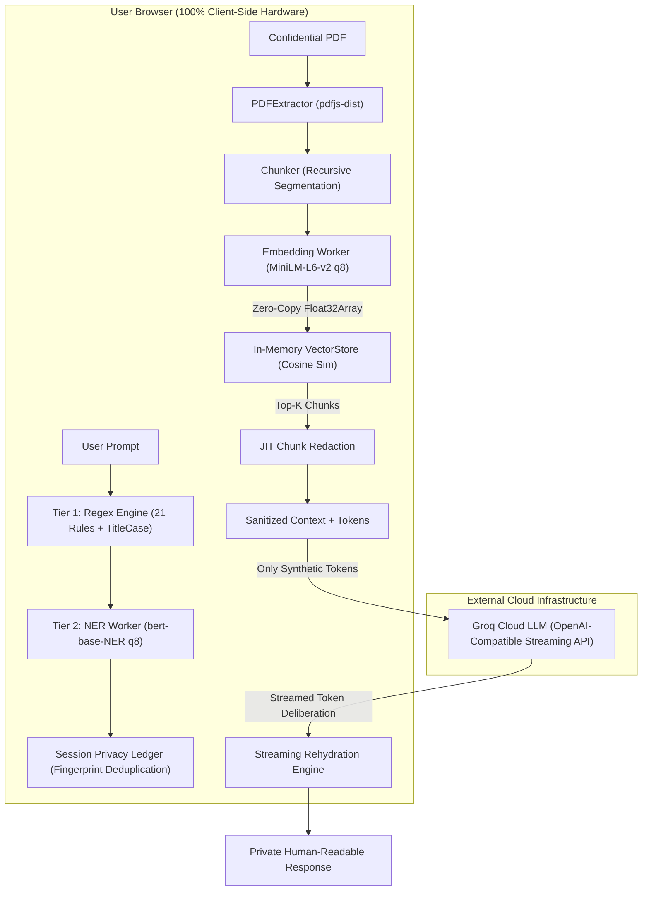

# 🛡️ Zero-Trust Edge AI Privacy Shield

A client-side Zero-Trust Retrieval-Augmented Generation (RAG) and Privacy Shield running on-device machine learning in the browser. 

Enterprise documents, confidential PDFs, and user queries are extracted, vectorized, and sanitized locally using WebGPU/WASM before any payload touches cloud infrastructure. Cloud LLMs only ever see synthetic privacy tokens (e.g. `[PERSON_1]`, `[ACCOUNT_NUM_1]`), and responses are rehydrated in real time on the user's device.

---

## ⚡ Architecture Overview



---

## 🔑 Key Engineering Highlights

### 1. Two-Tier Hybrid PII Sanitization Engine
PII extraction relies on a fail-safe hybrid pipeline that eliminates false positives while guaranteeing structured coverage:
- **Tier 1 (Deterministic Regex Defenses):** 21 hardened regex defenses (`src/utils/piiDefenses.ts`) covering global and regional identifiers:
  - Financial: Bank account numbers, routing numbers, credit cards, IFSC, UPI IDs.
  - Government IDs: US SSN, Indian PAN, Aadhaar, Passport, Driver's License, Voter ID.
  - Personal: Phone numbers, emails, IP addresses, medical/employee IDs.
  - **Title Case Guard:** Contextual person and location rules (`full name / name / emergency contact`, `my name is / i am`, `lives in / from`, `for / about / regarding`) enforce `requireTitleCase` (`isTitleCaseEntity`), preventing `/gi` from capturing ordinary lowercase prose (e.g., *"about the financial report"* is preserved, while *"about John Doe"* is masked).
  - **Keyword-Scoped DOB:** Scoped regex requiring preceding birth indicators (`dob`, `d.o.b.`, `date of birth`, `birth date`, `born on`) using `captureGroup: 1` so standard invoice or document dates remain intact.
- **Tier 2 (On-Device Named Entity Recognition):** `Xenova/bert-base-NER` (`q8`) running in an isolated Web Worker.
  - **Placeholder-Overlap Protection:** Scans `sourceText` for existing tokens (`/\[[A-Z][A-Z0-9_]*_\d+\]/g`) and automatically skips any BERT token prediction that overlaps an existing placeholder. This prevents partial subword predictions from corrupting pre-filtered tokens.

### 2. Session Privacy Ledger & Rehydration
- **Normalized Ledger Keying:** Ledger fingerprints are keyed using `normalizeLedgerKey(original)` (casing normalization and collapsed whitespace). Occurrences of `"John Doe"` and `"john doe"` consistently map to the identical session token `[PERSON_1]`.
- **Phantom History:** Conversational context (`phantomHistory`) passed to cloud LLMs preserves privacy tokens across multi-turn queries.
- **Length-Descending Rehydration:** Responses are reconstituted locally using length-descending sorting so compound tokens (`[PERSON_10]`) are substituted prior to prefix tokens (`[PERSON_1]`), avoiding token truncation.
- **Partial-Bracket Stream Suppression:** Prevents raw, incomplete token fragments (e.g., `[PERSO...`) from flickering on screen during live token streaming.

### 3. Client-Side RAG & Optimized Vector Engine
- **Local PDF Parsing:** `pdfjs-dist` executes parsing in a Web Worker, ensuring PDF bytes never leave client memory.
- **Zero-Copy Memory Transfers:** Embedding vectors generated by `Xenova/all-MiniLM-L6-v2` (`q8`) are returned from the worker via `ArrayBuffer` transferables, eliminating main-thread serialization overhead.
- **Vector Search Allocation Optimization:** `VectorStore.search()` computes cosine similarities, sorts, and slices `topK` first, only invoking `Float32Array` cloning on the final sliced results.

### 4. Semantic Routing & Meta-Intent Override
- **Dual-Mode Router:** Calculates cosine similarity against query embeddings. If similarity matches meet or exceed the semantic threshold (`0.12`), Document RAG mode is engaged (`topK: 5` for small docs, `15` for large docs). Lower scores route directly to General AI mode.
- **Meta-Intent Override:** Document-level queries matching `META_QUERY_PATTERN` (`summarize`, `this pdf`, `the document`) automatically force document context with scaled retrieval (`topK: 15`), bypassing similarity score thresholds.

### 5. Hardware Resilience & Cross-Origin Security
- **Dynamic Device Detection:** Replaces static `'gpu' in navigator` checks with an asynchronous `navigator.gpu?.requestAdapter()` probe. WebGPU is initialized only when a functional GPU adapter is acquired; otherwise, it falls back to WebAssembly.
- **Dynamic WASM JSEP / SIMD Switching:** Sets `env.backends.onnx.wasm.wasmPaths` to JSEP binaries under WebGPU, and SIMD-threaded binaries under WASM.
- **Quantized Weights (`dtype: 'q8'`):** Enforces 8-bit quantization across both WebGPU and WASM, keeping weights compact (~30–40 MB) and eliminating massive `fp32` fallback downloads.
- **Non-Destructive Network Error Handling:** Pipeline initialization catches WebGPU runtime failures and falls back to WASM, while bubbling network-level fetch errors directly to state.
- **CrossOrigin Security (`credentialless`):** Configured with `Cross-Origin-Embedder-Policy: credentialless` and `Cross-Origin-Opener-Policy: same-origin` to allow `SharedArrayBuffer` threading without blocking cross-origin model downloads from Hugging Face.

---

## 🛠️ Tech Stack

| Component | Technology | Role |
| :--- | :--- | :--- |
| **Framework** | React 18, TypeScript, Vite 5 | SPA and application runtime |
| **Styling** | Tailwind CSS | Dark-mode obsidian UI, glassmorphism |
| **Edge ML** | `@huggingface/transformers` (v3) | In-browser model pipelines |
| **Embeddings** | `Xenova/all-MiniLM-L6-v2` (`q8`) | 384-dimensional text embeddings |
| **NER Model** | `Xenova/bert-base-NER` (`q8`) | Named entity recognition (`PER`, `ORG`, `LOC`) |
| **Vector Index** | Custom `VectorStore` | In-memory cosine similarity search |
| **PDF Parser** | `pdfjs-dist` | In-browser PDF extraction |
| **Testing** | Vitest | Unit test suite |

---

## 🚀 Getting Started

### Prerequisites
- Node.js 18+ (Node 20+ recommended)
- A Groq API key (for cloud LLM completions)

### 1. Installation
```bash
git clone https://github.com/your-username/Zero-Trust-Edge-AI-Privacy-Shield.git
cd Zero-Trust-Edge-AI-Privacy-Shield
npm install
```

### 2. Environment Configuration
Create a `.env.local` file in the project root:
```bash
VITE_GROQ_API_KEY=gsk_your_groq_api_key_here
```

### 3. Start Development Server
```bash
npm run dev
```
Open `http://localhost:5173` in a modern browser (Chrome 113+, Edge, or any WebGPU/WASM-capable browser).

---

## 🧪 Testing & Verification

Run the full verification suite:

```bash
# Typecheck TypeScript
npm run typecheck

# Run Vitest Unit Tests
npm test

# Build Production Assets
npm run build
```

---

## 🔒 Privacy Guarantee

```
[User Document / Prompt] 
          │
          ▼
   ┌───────────────┐
   │ Edge Device   │  <--- Raw text, PII, and full embeddings NEVER leave this box.
   └──────┬────────┘
          │ (Masked tokens only: "[PERSON_1] has balance [ACCOUNT_NUM_1]")
          ▼
   ┌───────────────┐
   │ Cloud LLM     │  <--- Zero access to raw identities or sensitive data.
   └──────┬────────┘
          │ (Streamed token output)
          ▼
   ┌───────────────┐
   │ Local Browser │  <--- Rehydrated locally with Session Ledger before display.
   └───────────────┘
```
